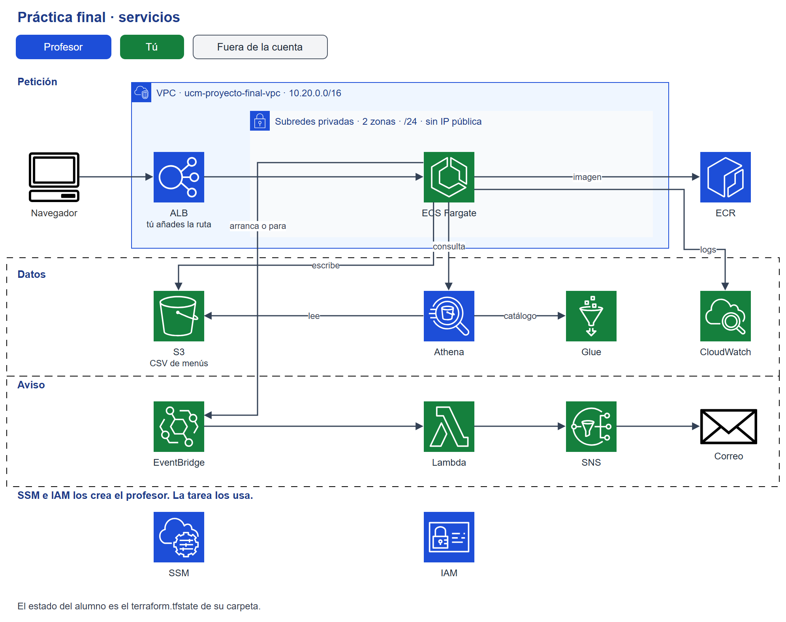
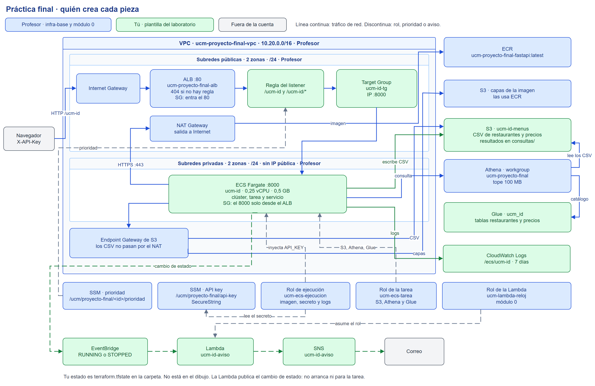

# Petición: publicar la API de menús

Hay que dejar la API de menús en el balanceador del taller y avisar por correo cuando una tarea arranca o se para. A partir de la arquitectura, cada sección es un fichero.

## Índice

1. [Contexto](#contexto)
2. [La plantilla](#la-plantilla)
3. [Arquitectura](#arquitectura)
4. [data.tf](#datatf)
5. [main.tf](#maintf)
6. [datos.tf](#datostf)
7. [aviso.tf](#avisotf)
8. [outputs.tf](#outputstf)
9. [Anexo A. Diagrama detallado](#anexo-a--diagrama-detallado)
10. [Anexo B. Decisiones que infra ya ha tomado](#anexo-b--decisiones-que-infra-ya-ha-tomado)
11. [Anexo C. Límites de la cuenta](#anexo-c--límites-de-la-cuenta)

## Contexto

Hay una API de menús. Quien la llama pide restaurantes o precios, y cada alta queda escrita como un CSV de una sola fila, sin cabecera, en S3. Esos CSV se consultan con Athena. Un fichero nuevo tiene que salir en la consulta siguiente, sin un proceso que lo registre.

La imagen ya está en el repositorio ECR `ucm-proyecto-final-fastapi`, etiqueta `latest`. Escucha en el puerto 8000. Hay que dejarla corriendo en ECS Fargate, detrás del balanceador del taller, en la ruta `/ucm-<id>`.

También hay que avisar por correo cuando una tarea de ese servicio arranca o se para. El aviso no enciende ni apaga el servicio. El Python que publica el correo está en `src/aviso/lambda_function.py`. No se cambia: se empaqueta y se conecta.

Lo único que cambia de una persona a otra es el identificador, el nombre del bucket, el correo del aviso y la prioridad que infra ya dejó en SSM. Tres variables no tienen valor por defecto: `identificador_alumno`, `bucket_datos` y `correo_aviso`. Van en `terraform.tfvars`, en esta carpeta. Terraform lo carga solo, sin `-var-file`: es el caso de un solo despliegue. El modelo está en `terraform.tfvars.example`. En un proyecto el tfvars se versiona con el código; una clave no va ahí. En esta plantilla el `.gitignore` excluye `*.tfvars` y deja el ejemplo, porque el correo es de quien aplica.

Donde el nombre no admite guion bajo ni espacios, el patrón es `ucm-{vuestro nombre}`. Con `ana_garcia` sale `ucm-ana-garcia`: el guion bajo pasa a guion. La ruta es ese nombre con barra delante. El puerto del contenedor es `8000`. El contenedor se llama `fastapi`. El aviso añade el sufijo `-aviso`.

En Glue es al revés: el guion no vale y el patrón es `ucm_{vuestro nombre}`. Con `ana_garcia` sale `ucm_ana_garcia`.

La región es `eu-west-1`. No se crea otra red, otro balanceador, otros roles, otro repositorio ni otro workgroup.

## La plantilla

Un recurso está escrito, está comentado o no está.

Un bloque comentado no existe para Terraform. `plan` no lo crea y `validate` no lo mira. Se quita el `#` de todo el bloque, no de una sola línea. Lo que ya tiene un valor se deja. Se rellena el hueco marcado con `TODO: Completar`. Un recurso que no está en el fichero se declara. Uno que ya está escrito no se vuelve a declarar al lado.

No hay bloque `locals`.

En cada recurso, la frase dice para qué sirve y el enlace abre la documentación. La tabla lista los argumentos. Si el argumento ya está en la plantilla, la tabla repite ese valor. Si es un nombre que escribes tú, la tabla pone el patrón `ucm-{vuestro nombre}-...` y el límite: guiones, sin espacios. Si es un número que ya vive en `variables.tf`, la tabla pone el número y toca mirar el fichero. Una frase dice qué pieza usar cuando la referencia la escribes tú.

| Fichero | Estado |
| --- | --- |
| `data.tf` | VPC, subredes, grupo de seguridad, ALB, listener y prioridad, escritos. ECR, tres roles y la API Key se declaran |
| `main.tf` | Target group y regla del listener, escritos. Servicio comentado. Log group, clúster y task definition se declaran |
| `datos.tf` | Dos tablas comentadas, con el `storage_descriptor` escrito. Bucket y base se declaran |
| `aviso.tf` | Regla de EventBridge escrita. El resto se declara |
| `outputs.tf` | Cinco salidas comentadas. La `description` ya está |
| `variables.tf` | Tres entradas sin default |
| `src/aviso/` | Python de la Lambda. No se cambia |

`data.tf` va delante de `main.tf` porque la regla del listener ya lee la prioridad. El bucket de `datos.tf` no espera al servicio. La task definition sí apunta a ese bucket y a esa base. `aviso.tf` filtra por `aws_ecs_cluster.cluster.arn`: hasta declarar el clúster, `terraform validate` falla en toda la carpeta.

## Arquitectura

Azul: el profesor. Verde: este terraform. Gris: fuera de la cuenta.

La línea continua es el camino de una petición, de una consulta o del aviso. El dibujo pieza a pieza, con la red y los roles, está en el [anexo A](#anexo-a--diagrama-detallado).

| Ya existe | Lo despliega este Terraform |
| --- | --- |
| VPC, subredes, Internet Gateway, NAT y el endpoint de S3 | Clúster, servicio, tarea y log group `/ecs/ucm-<id>` |
| ALB y su 404 por defecto | Target group y la regla `/ucm-<id>` |
| Repositorio ECR y la imagen | Bucket de CSV y tablas de Glue |
| Workgroup de Athena | |
| Roles `ucm-ecs-ejecucion`, `ucm-ecs-tarea` y `ucm-lambda-reloj` | Lambda, topic SNS y regla de EventBridge |
| Parámetro de prioridad y el SecureString de la API Key | |

## data.tf

Se lee lo que ya existe. Estos data sources no crean la VPC, el balanceador, los roles ni el repositorio.

### `aws_vpc.base`

VPC del taller. Ya está escrito.

Documentación: [`aws_vpc`](https://registry.terraform.io/providers/hashicorp/aws/latest/docs/data-sources/vpc).

| Argumento | Valor |
| --- | --- |
| `tags.Name` | `ucm-proyecto-final-vpc` |

### `aws_subnets.privadas`

Subredes privadas de esa VPC. Ya está escrito.

Documentación: [`aws_subnets`](https://registry.terraform.io/providers/hashicorp/aws/latest/docs/data-sources/subnets).

| Argumento | Valor |
| --- | --- |
| `filter` `vpc-id` | `data.aws_vpc.base.id` |
| `tags.Tier` | `privada` |

### `aws_security_group.tareas`

Grupo de seguridad de las tareas. Ya está escrito. Solo acepta tráfico del ALB, al puerto 8000.

Documentación: [`aws_security_group`](https://registry.terraform.io/providers/hashicorp/aws/latest/docs/data-sources/security_group).

| Argumento | Valor |
| --- | --- |
| `name` | `ucm-proyecto-final-tareas` |
| `vpc_id` | `data.aws_vpc.base.id` |

### `aws_lb.base`

ALB compartido. Ya está escrito.

Documentación: [`aws_lb`](https://registry.terraform.io/providers/hashicorp/aws/latest/docs/data-sources/lb).

| Argumento | Valor |
| --- | --- |
| `name` | `ucm-proyecto-final-alb` |

### `aws_lb_listener.http`

Listener HTTP de ese ALB. Ya está escrito.

Documentación: [`aws_lb_listener`](https://registry.terraform.io/providers/hashicorp/aws/latest/docs/data-sources/lb_listener).

| Argumento | Valor |
| --- | --- |
| `load_balancer_arn` | `data.aws_lb.base.arn` |
| `port` | `80` |

### `aws_ssm_parameter.prioridad`

Prioridad de la regla en el listener. Es un String. Ya está escrito: lo usa `aws_lb_listener_rule.api`.

Documentación: [`aws_ssm_parameter`](https://registry.terraform.io/providers/hashicorp/aws/latest/docs/data-sources/ssm_parameter).

| Argumento | Valor |
| --- | --- |
| `name` | `/ucm/proyecto-final/${var.identificador_alumno}/prioridad` |

### `aws_ecr_repository.fastapi`

Repositorio de la imagen. No está en la plantilla. Se declara.

Documentación: [`aws_ecr_repository`](https://registry.terraform.io/providers/hashicorp/aws/latest/docs/data-sources/ecr_repository).

| Argumento | Valor |
| --- | --- |
| `name` | `ucm-proyecto-final-fastapi` |

### `aws_iam_role.ecs_ejecucion`

Rol con el que el agente de ECS baja la imagen, escribe logs e inyecta el secreto. No está en la plantilla. Se declara. No se puede crear otro rol.

Documentación: [`aws_iam_role`](https://registry.terraform.io/providers/hashicorp/aws/latest/docs/data-sources/iam_role).

| Argumento | Valor |
| --- | --- |
| `name` | `ucm-ecs-ejecucion` |

### `aws_iam_role.ecs_tarea`

Rol del proceso de la API, para S3, Athena y Glue. No está en la plantilla. Se declara.

Documentación: [`aws_iam_role`](https://registry.terraform.io/providers/hashicorp/aws/latest/docs/data-sources/iam_role).

| Argumento | Valor |
| --- | --- |
| `name` | `ucm-ecs-tarea` |

### `aws_iam_role.lambda`

Rol de la Lambda de aviso. Lo crea el módulo 0. Publica en topics `ucm-*` y escribe logs de Lambda. No está en la plantilla. Se declara.

Documentación: [`aws_iam_role`](https://registry.terraform.io/providers/hashicorp/aws/latest/docs/data-sources/iam_role).

| Argumento | Valor |
| --- | --- |
| `name` | `ucm-lambda-reloj` |

### `aws_ssm_parameter.api_key`

API Key compartida. Es un SecureString. No está en la plantilla. Se declara. Con `with_decryption = false` Terraform no descifra el parámetro. En la tarea entra el ARN, no el valor.

Documentación: [`aws_ssm_parameter`](https://registry.terraform.io/providers/hashicorp/aws/latest/docs/data-sources/ssm_parameter).

| Argumento | Valor |
| --- | --- |
| `name` | `/ucm/proyecto-final/api-key` |
| `with_decryption` | `false` |

## main.tf

Fargate. No EC2 y no un capacity provider. El log group, el clúster y la task definition se declaran. El target group y la regla ya están. El servicio está comentado.

### `aws_cloudwatch_log_group.api`

Logs del servicio. No está en la plantilla. Se declara. La retención corta el coste de dejar el grupo creciendo.

Documentación: [`aws_cloudwatch_log_group`](https://registry.terraform.io/providers/hashicorp/aws/latest/docs/resources/cloudwatch_log_group).

| Argumento | Valor |
| --- | --- |
| `name` | `/ecs/ucm-{vuestro nombre}`. Guiones, sin espacios |
| `retention_in_days` | `7` |

### `aws_ecs_cluster.cluster`

Clúster de este terraform. No está en la plantilla. Se declara. La etiqueta es `cluster`: [`aviso.tf`](#avisotf) usa `aws_ecs_cluster.cluster.arn`. Hasta declararlo, `validate` falla. Container Insights se cobra aparte.

Documentación: [`aws_ecs_cluster`](https://registry.terraform.io/providers/hashicorp/aws/latest/docs/resources/ecs_cluster).

| Argumento | Valor |
| --- | --- |
| `name` | `ucm-{vuestro nombre}-cluster`. Guiones, sin espacios |
| `setting.name` | `containerInsights` |
| `setting.value` | `disabled` |

### `aws_ecs_task_definition.api`

Definición de la tarea. No está en la plantilla. Se declara. 0,25 vCPU y 512 MB. El contenedor va en `container_definitions`.

Documentación: [`aws_ecs_task_definition`](https://registry.terraform.io/providers/hashicorp/aws/latest/docs/resources/ecs_task_definition).

| Argumento | Valor |
| --- | --- |
| `family` | `ucm-{vuestro nombre}-api`. Guiones, sin espacios |
| `requires_compatibilities` | `["FARGATE"]` |
| `network_mode` | `awsvpc` |
| `cpu` | `256` |
| `memory` | `512` |
| `execution_role_arn` | Rol `ecs_ejecucion` |
| `task_role_arn` | Rol `ecs_tarea` |
| `container_definitions` | Un contenedor, en la tabla siguiente |

Contenedor:

| Argumento | Valor |
| --- | --- |
| `name` | `fastapi` |
| `image` | URL del repositorio `fastapi` con la etiqueta `imagen_tag` |
| `essential` | `true` |
| `portMappings.containerPort` | `8000` |
| `portMappings.protocol` | `tcp` |
| `logConfiguration.logDriver` | `awslogs` |
| `awslogs-group` | Nombre del log group de la API |
| `awslogs-region` | Región de la infra base |
| `awslogs-stream-prefix` | `api` |

`environment` lleva un objeto `{ name, value }` por variable. Si falta una, la API no consulta o no arranca bien.

| Variable | Valor |
| --- | --- |
| `API_ROOT_PATH` | `/ucm-{vuestro nombre}`. Guiones, sin espacios |
| `S3_BUCKET` | Nombre del bucket de datos |
| `S3_PREFIJO_RESTAURANTES` | `restaurantes` |
| `S3_PREFIJO_PRECIOS` | `precios` |
| `ATHENA_DATABASE` | Nombre de la base de Glue |
| `ATHENA_TABLE_RESTAURANTES` | `restaurantes` |
| `ATHENA_TABLE_PRECIOS` | `precios` |
| `ATHENA_WORKGROUP` | `ucm-proyecto-final` |
| `ATHENA_OUTPUT` | URI `s3://` del bucket de datos, bajo `consultas/` |

`secrets` lleva una entrada. ECS inyecta el valor al arrancar. No queda en la definición.

| Argumento | Valor |
| --- | --- |
| `name` | `API_KEY` |
| `valueFrom` | ARN del parámetro de la API Key |

### `aws_lb_target_group.api`

Destinos de la API, por IP, en la VPC del taller. Ya está escrito. El nombre no pasa de 32 caracteres: con el identificador de como mucho 25, entra.

Documentación: [`aws_lb_target_group`](https://registry.terraform.io/providers/hashicorp/aws/latest/docs/resources/lb_target_group).

| Argumento | Valor |
| --- | --- |
| `name` | `ucm-${replace(var.identificador_alumno, "_", "-")}-tg` |
| `port` | `8000` |
| `protocol` | `HTTP` |
| `target_type` | `ip` |
| `vpc_id` | `data.aws_vpc.base.id` |
| `deregistration_delay` | `30` |
| `health_check.path` | `/ucm-${replace(var.identificador_alumno, "_", "-")}/health` |
| `health_check.protocol` | `HTTP` |
| `health_check.matcher` | `200` |
| `health_check.healthy_threshold` | `2` |
| `health_check.unhealthy_threshold` | `3` |
| `health_check.timeout` | `5` |
| `health_check.interval` | `15` |

### `aws_lb_listener_rule.api`

Reenvía al target group las rutas de este alumno. Ya está escrito. La prioridad sale del parámetro SSM, no se elige a mano.

Documentación: [`aws_lb_listener_rule`](https://registry.terraform.io/providers/hashicorp/aws/latest/docs/resources/lb_listener_rule).

| Argumento | Valor |
| --- | --- |
| `listener_arn` | `data.aws_lb_listener.http.arn` |
| `priority` | `tonumber(data.aws_ssm_parameter.prioridad.insecure_value)` |
| `action.type` | `forward` |
| `action.target_group_arn` | `aws_lb_target_group.api.arn` |
| `path_pattern.values` | `/ucm-${replace(var.identificador_alumno, "_", "-")}` y `/ucm-${replace(var.identificador_alumno, "_", "-")}/*` |

Sin la barra del segundo patrón, `/ucm-ana*` también capturaría `/ucm-ana-garcia`. La raíz del ALB, sin esta ruta, sigue respondiendo 404.

### `aws_ecs_service.api`

Servicio Fargate, una tarea, en las subredes privadas. Está comentado. Se descomenta y se rellenan los argumentos vacíos. Los que ya tienen valor se dejan. `depends_on` se queda: si el target group no está enganchado al ALB, el servicio no arranca.

Documentación: [`aws_ecs_service`](https://registry.terraform.io/providers/hashicorp/aws/latest/docs/resources/ecs_service).

| Argumento | Valor |
| --- | --- |
| `name` | `ucm-{vuestro nombre}-api`. Guiones, sin espacios |
| `cluster` | Id del clúster |
| `task_definition` | ARN de la task definition |
| `desired_count` | `1`. Revisa `variables.tf` |
| `launch_type` | `FARGATE` |
| `network_configuration.subnets` | Ids de las subredes privadas ya creadas |
| `network_configuration.security_groups` | Id del grupo de seguridad de las tareas |
| `network_configuration.assign_public_ip` | `false` |
| `load_balancer.target_group_arn` | `aws_lb_target_group.api.arn` |
| `load_balancer.container_name` | `fastapi` |
| `load_balancer.container_port` | `8000` |
| `depends_on` | `[aws_lb_listener_rule.api]` |

## datos.tf

El workgroup `ucm-proyecto-final` ya existe. Este terraform no lo crea. El tope del workgroup y por qué no hay crawler están en el [anexo B](#anexo-b--decisiones-que-infra-ya-ha-tomado).

El bucket y la base se declaran. Las dos tablas están comentadas. Cada CSV es una fila, sin cabecera. La tabla apunta al prefijo y Athena lista los objetos.

### `aws_s3_bucket.datos`

Bucket de los CSV. No está en la plantilla. Se declara. En `terraform.tfvars`, `bucket_datos` es `ucm-<id>-menus`. `force_destroy` en `true` permite el `destroy` cuando ya hay objetos.

Documentación: [`aws_s3_bucket`](https://registry.terraform.io/providers/hashicorp/aws/latest/docs/resources/s3_bucket).

| Argumento | Valor |
| --- | --- |
| `bucket` | Variable `bucket_datos` |
| `force_destroy` | `true` |

### `aws_glue_catalog_database.menus`

Base de Glue de este alumno. No está en la plantilla. Se declara.

Documentación: [`aws_glue_catalog_database`](https://registry.terraform.io/providers/hashicorp/aws/latest/docs/resources/glue_catalog_database).

| Argumento | Valor |
| --- | --- |
| `name` | `ucm_{vuestro nombre}`. Guiones bajos: Glue no admite el guion |

### `aws_glue_catalog_table.restaurantes`

Tabla externa del prefijo `restaurantes/`. Está comentada. El `storage_descriptor` ya está: ubicación con barra final, `LazySimpleSerDe`, separador coma y sin comillas. No se reescribe. Falta el `type` de cada columna. El nombre de la columna ya está.

Documentación: [`aws_glue_catalog_table`](https://registry.terraform.io/providers/hashicorp/aws/latest/docs/resources/glue_catalog_table).

| Argumento | Valor |
| --- | --- |
| `name` | `restaurantes` |
| `database_name` | Nombre de la base de Glue |
| `table_type` | `EXTERNAL_TABLE` |
| `parameters.EXTERNAL` | `TRUE` |
| `parameters.classification` | `csv` |
| `columns` `id` | `string` |
| `columns` `nombre` | `string` |
| `columns` `descripcion` | `string` |
| `columns` `maps_url` | `string` |

### `aws_glue_catalog_table.precios`

Tabla externa del prefijo `precios/`. Está comentada. El `storage_descriptor` ya está y no se reescribe.

Documentación: [`aws_glue_catalog_table`](https://registry.terraform.io/providers/hashicorp/aws/latest/docs/resources/glue_catalog_table).

| Argumento | Valor |
| --- | --- |
| `name` | `precios` |
| `database_name` | Nombre de la base de Glue |
| `table_type` | `EXTERNAL_TABLE` |
| `parameters.EXTERNAL` | `TRUE` |
| `parameters.classification` | `csv` |
| `columns` `id` | `string` |
| `columns` `restaurante_id` | `string` |
| `columns` `precio` | `double` |
| `columns` `momento` | `timestamp` |

`precio` se escribe con dos decimales (`12.50`). `momento` se escribe en UTC como `2026-10-16 09:22:00`, que es el formato que este serde lee como `timestamp`. Un campo de texto no puede llevar comas: el separador es la coma y el fichero no usa comillas.

## aviso.tf

La Lambda publica en SNS cuando una tarea de este clúster pasa a `RUNNING` o a `STOPPED`. También si alguien la para a mano. No hay horario. La regla ya está. El resto se declara. El rol es [`aws_iam_role.lambda`](#aws_iam_rolelambda).

### `aws_sns_topic.aviso`

Topic del correo. No está en la plantilla. Se declara.

Documentación: [`aws_sns_topic`](https://registry.terraform.io/providers/hashicorp/aws/latest/docs/resources/sns_topic).

| Argumento | Valor |
| --- | --- |
| `name` | `ucm-{vuestro nombre}-aviso`. Guiones, sin espacios |

### `aws_sns_topic_subscription.aviso`

Suscripción al topic. No está en la plantilla. Se declara. SNS no entrega nada hasta que se confirma el enlace.

Documentación: [`aws_sns_topic_subscription`](https://registry.terraform.io/providers/hashicorp/aws/latest/docs/resources/sns_topic_subscription).

| Argumento | Valor |
| --- | --- |
| `topic_arn` | ARN del topic de aviso |
| `protocol` | `email` |
| `endpoint` | Correo del aviso |

### `aws_cloudwatch_log_group.aviso`

Logs de la función. No está en la plantilla. Se declara. El nombre tiene que existir antes que la Lambda: si no, Lambda crea el grupo sin retención.

Documentación: [`aws_cloudwatch_log_group`](https://registry.terraform.io/providers/hashicorp/aws/latest/docs/resources/cloudwatch_log_group).

| Argumento | Valor |
| --- | --- |
| `name` | `/aws/lambda/ucm-{vuestro nombre}-aviso`. Guiones, sin espacios |
| `retention_in_days` | `7` |

### `archive_file.aviso`

Zip del Python. No está en la plantilla. Se declara. El fichero no se edita.

Documentación: [`archive_file`](https://registry.terraform.io/providers/hashicorp/archive/latest/docs/data-sources/archive_file).

| Argumento | Valor |
| --- | --- |
| `type` | `zip` |
| `source_file` | `${path.module}/src/aviso/lambda_function.py` |
| `output_path` | `${path.module}/aviso.zip` |

### `aws_lambda_function.aviso`

Función que publica el correo. No está en la plantilla. Se declara. `memory_size` se deja sin poner: el default es 128 MB. Sin `source_code_hash`, un cambio en el Python no se despliega. El Python lee `IDENTIFICADOR_ALUMNO` y `SNS_TOPIC_ARN`.

Documentación: [`aws_lambda_function`](https://registry.terraform.io/providers/hashicorp/aws/latest/docs/resources/lambda_function).

| Argumento | Valor |
| --- | --- |
| `function_name` | `ucm-{vuestro nombre}-aviso`. Guiones, sin espacios |
| `role` | Rol `lambda` |
| `filename` | Ruta del zip |
| `source_code_hash` | Hash del zip |
| `handler` | `lambda_function.lambda_handler` |
| `runtime` | `python3.12` |
| `timeout` | `10` |
| `environment.variables.IDENTIFICADOR_ALUMNO` | Identificador del alumno |
| `environment.variables.SNS_TOPIC_ARN` | ARN del topic de aviso |
| `depends_on` | Log group de la función |

### `aws_cloudwatch_event_rule.aviso`

Regla que escucha el cambio de estado de las tareas de este clúster. Ya está escrita. El patrón no se cambia.

Documentación: [`aws_cloudwatch_event_rule`](https://registry.terraform.io/providers/hashicorp/aws/latest/docs/resources/cloudwatch_event_rule).

| Argumento | Valor |
| --- | --- |
| `name` | `ucm-${replace(var.identificador_alumno, "_", "-")}-aviso` |
| `description` | `Tareas que pasan a RUNNING o STOPPED.` |
| `event_pattern` | Tareas de este clúster que pasan a `RUNNING` o `STOPPED`. El JSON ya está en el recurso |

### `aws_cloudwatch_event_target.aviso`

Destino de la regla. No está en la plantilla. Se declara. Sin esto, la regla existe y no llama a la función.

Documentación: [`aws_cloudwatch_event_target`](https://registry.terraform.io/providers/hashicorp/aws/latest/docs/resources/cloudwatch_event_target).

| Argumento | Valor |
| --- | --- |
| `rule` | Nombre de la regla de aviso |
| `arn` | ARN de la función |

### `aws_lambda_permission.aviso`

Permiso para que EventBridge invoque la función, limitado a esta regla. No está en la plantilla. Se declara. Sin el permiso, el target no llega a ejecutarse.

Documentación: [`aws_lambda_permission`](https://registry.terraform.io/providers/hashicorp/aws/latest/docs/resources/lambda_permission).

| Argumento | Valor |
| --- | --- |
| `statement_id` | `AllowExecutionFromEventBridge` |
| `action` | `lambda:InvokeFunction` |
| `principal` | `events.amazonaws.com` |
| `function_name` | Nombre de la función |
| `source_arn` | ARN de la regla de aviso |

## outputs.tf

Cinco salidas comentadas. Sirven para probar. La `description` ya está. Se rellena `value`.

### `dns_alb`

DNS del ALB compartido.

| Argumento | Valor |
| --- | --- |
| `value` | DNS del ALB compartido |

### `url_api`

URL de la API, con el prefijo de este alumno.

| Argumento | Valor |
| --- | --- |
| `value` | URL del ALB con el prefijo `/ucm-<id>/` |

### `bucket_datos`

Nombre del bucket de CSV.

| Argumento | Valor |
| --- | --- |
| `value` | Nombre del bucket de datos |

### `base_athena`

Nombre de la base de Glue.

| Argumento | Valor |
| --- | --- |
| `value` | Nombre de la base de Glue |

### `funcion_aviso`

Nombre de la función Lambda del aviso.

| Argumento | Valor |
| --- | --- |
| `value` | Nombre de la función de aviso |

### Cierre

La documentación es esa URL de la API con `docs` al final. La prioridad se ve en el plan de la regla.

| Prueba | Resultado |
| --- | --- |
| `GET /ucm-<id>/health` en el ALB | `{"status":"ok"}` |
| `GET /ucm-<id>/` | responde la API, con el identificador |
| `GET /ucm-<id>/docs` | Swagger de la API |
| `GET /` | `404` y el texto `Ruta no encontrada` |
| Arrancar o parar una tarea | correo, después de confirmar el enlace de SNS |

El servicio tarda uno o dos minutos en pasar el health check.

Al terminar se destruye lo desplegado en este terraform: clúster, servicio, target group, regla, bucket, tablas, Lambda, topic y log groups. El ALB, la red, los roles y el repositorio los retira infra. Una regla o un target group que se queden hacen fallar ese retiro.

## Anexo A — Diagrama detallado

Azul: ya está desplegado. Verde: lo despliega este terraform. Gris: fuera de la cuenta. La línea continua es tráfico. La discontinua es un rol, la prioridad o el aviso.

`id` es el identificador con los guiones bajos pasados a guion (`ana_garcia` → `ana-garcia`). En Glue el guion pasa a guion bajo (`ucm_ana_garcia`).

La petición entra por el ALB compartido. La tarea vive en subredes privadas, sin IP pública. El rol de ejecución inyecta `API_KEY` al arrancar. La Lambda publica el cambio de estado. La tabla de Glue apunta al prefijo y Athena lista los CSV en cada consulta.

## Anexo B — Decisiones que infra ya ha tomado

Estas decisiones no se negocian. El terraform se apoya en ellas.

**Un ALB para todos.** Un balanceador por servicio se paga entero aunque no reciba tráfico. El listener responde 404 a cualquier ruta sin regla, así un prefijo mal escrito no entra en el servicio de otro. La regla de cada uno lleva una prioridad distinta: el parámetro SSM la asigna infra, porque dos reglas con la misma prioridad no conviven en el listener. La posición en la lista de alumnos, por diez, deja hueco entre medias. Quitar a alguien del medio cambia la prioridad de los siguientes.

**La tarea no tiene IP pública.** Vive en subredes privadas. El grupo de seguridad solo acepta tráfico del ALB, al puerto 8000, y solo sale por el 443. Hay un solo NAT para toda la cuenta de prácticas: en producción sería uno por zona, y aquí el segundo no aporta y sí se paga. El endpoint de S3 es de tipo gateway y no se factura: las capas de ECR se descargan de S3 y no cruzan el NAT.

**Dos roles, y ninguno lo crea este terraform.** El de ejecución lo usa el agente de ECS para bajar la imagen, escribir logs e inyectar el secreto al arrancar. El de la tarea lo usa el proceso de la API para S3, Athena y Glue. Separarlos evita que la aplicación pueda leer el parámetro del secreto o reescribir su propia definición. El rol de la Lambda es el del módulo 0: publica en topics `ucm-*` y escribe sus logs.

**La API Key no está en el código ni en la definición.** Es un SecureString. La definición guarda el ARN. ECS lee el valor al arrancar la tarea y lo pasa como `API_KEY`. Quien mire la task definition ve el ARN, no la clave.

**Un workgroup de Athena, con tope.** `bytes_scanned_cutoff_per_query` está en 100 MB para que una consulta mal escrita no recorra de más. `enforce_workgroup_configuration` está en false: si estuviera en true, Athena ignoraría el bucket de resultados que manda cada servicio y exigiría el del workgroup. Cada uno escribe los resultados en su bucket, bajo `consultas/`.

**Sin crawler.** La tabla apunta al prefijo y declara las columnas. Athena lista los objetos en cada consulta, así que un CSV nuevo entra sin lanzar nada, sin un rol extra y sin el coste de una ejecución del crawler. El crawler, además, inferiría el esquema a su manera.

**El estado es local.** `versions.tf` no lleva bloque `backend`. Terraform escribe `terraform.tfstate` en esta carpeta. El `.gitignore` lo excluye, igual que `terraform.tfstate.backup`. Es un solo entorno: un directorio, un `terraform.tfvars` y un estado. Dos `apply` a la vez no escriben los dos: el segundo se para al ver `.terraform.tfstate.lock.info`. Si el proceso murió y el lock sigue, `terraform force-unlock` suelta el id del error. No se borra el estado. `.terraform.lock.hcl` es el lock del provider: fija la versión que bajó `init` y se versiona. `force-unlock` no lo abre.

**El aviso no programa el horario.** Infra no ha pedido apagar el servicio a una hora. El evento sale cuando la tarea cambia de estado, también si alguien la para a mano. Confirmar el correo de SNS es parte del cierre: hasta entonces la suscripción no entrega.

## Anexo C — Límites de la cuenta

El usuario con el que se aplica no puede crear roles ni grupos de seguridad. `iam:PassRole` solo vale para `ucm-ecs-ejecucion` y `ucm-ecs-tarea`, y solo hacia `ecs-tasks.amazonaws.com`.

Los nombres que se creen tienen que poder acotarse: clústeres, servicios, target groups, topics y buckets bajo `ucm-`, log groups del servicio bajo `/ecs/ucm-`, bases de Glue bajo `ucm_`. Las reglas del listener no llevan nombre en el ARN. La política deja crearlas en el listener del taller.
